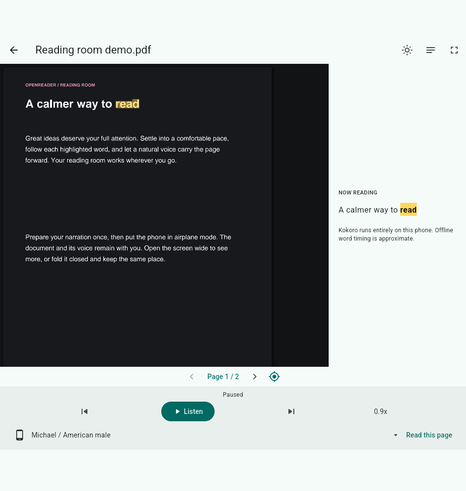
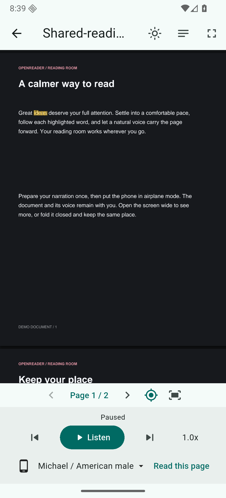
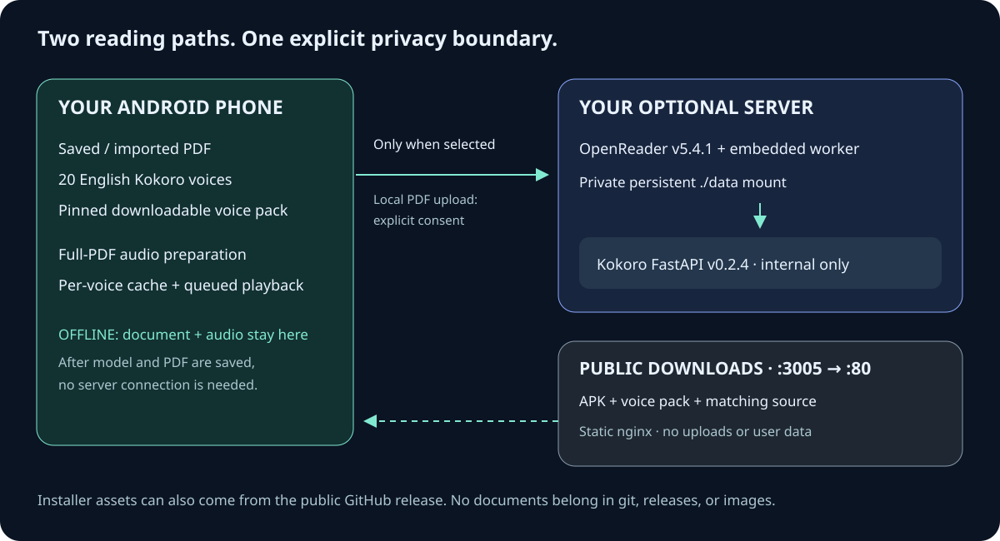

<p align="center">
  
</p>

<p align="center">
  <strong>A native Android PDF reader that can read along with you — on your phone, or through your own server.</strong>
  <br>
  Android 7.0+ · Flutter · 20 English Kokoro voices · GPL-3.0-or-later
</p>

<p align="center">
  <a href="#install">Install</a> ·
  <a href="#offline-first-reading">Offline reading</a> ·
  <a href="#optional-self-hosted-server">Self-host</a> ·
  <a href="#build-and-run-the-android-app">Build</a> ·
  <a href="#privacy-is-a-release-requirement">Privacy</a>
</p>

> **v1.3.0:** fixes phone narration stopping on number-only passages and adds
> server-generated narration downloads for genuinely offline playback.
> Install the signed APK from [Releases](https://github.com/gil906/openreader_mobile/releases/tag/v1.3.0).
> Existing phone narration checkpoints and the installed voice pack are preserved.

## What this app is

OpenReader Native is an **unofficial, independent Android client** for reading
PDFs with synchronized speech. It is not a web view, an official upstream
OpenReader release, or a promise of full web-client parity.

The app has three deliberately separate speech paths:

- **On-device:** saved/imported PDF + downloaded English model + speech and audio
  preparation on your Android device. No server is needed once these are saved.
- **Your server:** sign in to a self-hosted OpenReader installation and use its
  library and configured speech provider. Network connectivity is required.
- **Saved server audio:** generate with your server's current voice/blend, then
  download its complete MP3 and PDF timing data. Once saved, playback needs
  neither the server, internet access, nor the phone voice pack.

EPUB, DOCX, and other web-only workflows are **future work**, not native features.
The optional upstream web application has a different feature set.

## The v1.3.0 experience

The native update has been validated on Android test builds:

| Area | Native update |
|---|---|
| Documents | Import a PDF from Android storage, save a server PDF for offline use, and receive PDF **Open with / Share** intents |
| Speech | 20 English Kokoro voices with the downloadable full-quality voice pack |
| Preparation | Choose phone or server generation; prepare an entire PDF, stop/resume, and permanently retain narration on the phone |
| Playback | Continuous preloaded/queued playback, paragraph-tap navigation, and separate speed preferences for each speech source |
| Read-along | PDF word highlighting; phone timing is approximate; saved server timing retains exact server words when available and explicitly estimates missing alignments |
| Reading surface | Native fullscreen, dark PDF pages, adaptive phone/foldable layouts, and a **Fit page** control with size-aware fitting |
| Source choice | Phone / offline, Saved server / offline, or live Server; local PDF upload requires consent |

**Important limits:** phone generation can take time, battery, and storage.
Keep the preparation screen open. Server generation runs on your server;
stopping on the phone does not stop a shared server job. Return and resume to
download the completed recording. There is **no foreground
background-service guarantee**; Android may interrupt work when the app is
backgrounded or the process is killed. Resume is the recovery path, not a claim
of uninterrupted background processing. Approximate offline highlighting is
not forced-alignment precision. Queued playback still depends on available
prepared audio, document text quality, and device performance.

### Validation before release packaging

The native validation pass includes focused unit regressions and end-to-end
checks of full-book prepare/stop/resume, PDF-word glyph semantics, consented
server upload, source switching, and independently stored speed preferences.
Prepared continuous playback also passed with the model/transient cache removed
and Android in actual airplane mode. This proves playback of retained prepared
audio without synthesis/network access, not generation of new speech without
the model. New text or another voice still needs the offline pack.

The v1.3.0 native regression additionally synthesizes numeric-only and technical
passages with the actual Kokoro model, then generates and downloads server
narration. Its saved MP3 crosses passages, seeks, and highlights PDF glyphs in
actual airplane mode with the model and transient audio removed.

### Choose where narration is generated

1. Save a server PDF for offline use, or import a PDF in **Offline library**.
2. Open its menu → **Prepare entire PDF audio**.
3. Under **Generate audio using**, choose **Phone / offline voice** or
   **Server / save on phone**. Server preparation uses your configured server
   voice/blend; select that voice in the upstream web settings first.
4. Keep this screen open until audio is saved. Interrupted preparation resumes
   cached work; MP3 downloads resume when the server supplies a strong validator.
5. In the PDF's audio-source menu, choose **Phone / offline**,
   **Saved server / offline**, or **Server** for live streaming.

Phone generation speaks numeric passages rather than discarding them. Formatting
separators become counted short pauses; readable synthesis failures remain
explicit. Server exports containing skipped passages are retried once and never
selected as a complete recording if passages are still missing.

Cold- and warm-start Android PDF content-URI handoffs passed independently.
The app's explicit PDF intent handler owns **VIEW / SEND** flows; Flutter's
generic deep-link handler is intentionally disabled for this purpose.
Native phone validation also covered the Fit page control and size-aware PDF
layout. These checks do not replace verification of the final signed APK and
public release assets.

## A look at the reader

These are actual native Android captures using only fabricated reading-room
demo content, reviewed by the maintainer for public release:

| Wide prepared read-along | Native phone reader |
|---|---|
|  |  |

The artwork in `docs/art/` is original SVG, not a capture of user data.
See the [screenshot provenance requirements](docs/screenshots/README.md).

## Install

### Android APK

1. Open the public [v1.3.0 release](https://github.com/gil906/openreader_mobile/releases/tag/v1.3.0).
2. Download `OpenReader-Native-v1.3.0.apk` and `SHA256SUMS`.
3. Check its checksum against the release manifest. For example, on a desktop:
   ```sh
   sha256sum OpenReader-Native-v1.3.0.apk
   ```
4. Transfer/open the APK on Android and allow installation from that source if
   Android prompts. Turn that permission off again when finished.
5. Launch the app. A fresh install has **no preset server or email**. Existing
   saved settings are retained on update. Offline use does not require an account.

Use Android API 24+ with sufficient free storage for the model, documents, and
prepared audio. Device ABI support is determined by the actual release APK;
maintainers must record it in the release notes after inspecting the build.

Install updates from the same trusted publisher/signing certificate. A debug
APK or an APK signed by someone else cannot replace an existing release install.
Never commit or distribute the private signing key.

### Where to get the voice pack

A standalone fresh install can obtain the pinned pack from the public GitHub
release. Configured users can instead use their host's installer/download page
on port **3005**. The download container is not the document server.

| Property | Value |
|---|---|
| Asset | `kokoro-english-v1.zip` |
| Size | Approximately 324 MiB |
| Quality | Full-quality model, not an app-side quantized substitute |
| SHA-256 | `abaff9787f8b73c28dc2876c7610bcc162b0fc29cd6fa7556af72e20b8f9e8d7` |
| Public source | [v1.3.0 voice pack](https://github.com/gil906/openreader_mobile/releases/download/v1.3.0/kokoro-english-v1.zip) |

Download and install the pack through the app's offline voice setup. Keep the
network connection available during the initial download. Verify the pinned
checksum if transferring the pack separately:

```sh
printf '%s  %s\n' \
  abaff9787f8b73c28dc2876c7610bcc162b0fc29cd6fa7556af72e20b8f9e8d7 \
  kokoro-english-v1.zip | sha256sum -c -
```

The pack is a **release asset**, not a file to add to git.

## Offline-first reading

1. Install the offline English pack.
2. Import a PDF using the app or Android's **Open with / Share** menu, or
   explicitly save a server PDF onto the phone.
3. Choose the **on-device/offline** speech source and an English voice.
4. Prepare the PDF's audio if you want to avoid synthesis waits while reading.
   Keep the preparation screen open; cancel/resume if necessary.
5. Play, change the local playback speed, or tap a paragraph to navigate.
   Use **Fit page** to restore a comfortable whole-page view after zooming or
   changing the available screen size.

Full narration preparation uses the **phone/on-device voice**, not the server
voice. Prepared audio and stop/resume progress are local, pinned per PDF/voice
outside the ordinary transient LRU cache. Keep the preparation screen open;
after stopping or interruption, resume that same PDF/voice. Switching voices may
require new preparation and uses additional storage. Offline word timing is
approximate; server speech uses the server's exact word timing when that timing
is supplied. Speed preferences are stored **separately for phone and server**,
and highlighting follows the selected source rather than stale local state.

For a local-only PDF, choosing server narration is a data-transfer decision.
Read and confirm the upload prompt before sending that PDF to **your** server.
Do not upload anything you are not entitled to share with that server/operator.
Scanned/image-only, encrypted, or text-extraction-resistant PDFs may not provide
usable narration; no native OCR workflow is promised.

### Make it your Android PDF default

The PDF default is **your Android choice**, not something the app silently sets:

1. Open a PDF from your file manager or another app.
2. Choose **Open with → OpenReader Native → Always** when Android offers it.
3. If an old viewer opens automatically, visit **Android Settings → Apps →
   [old viewer] → Open by default → Clear defaults** (wording varies by device),
   then open the PDF again and choose OpenReader Native.

Some apps use their own embedded viewers and do not show Android's chooser.
Use their external **Open with** or **Share** action instead. Share is generally
a one-time handoff and does not by itself change the system default.

## Optional self-hosted server



The supplied Compose file uses upstream images unchanged:

| Service | Pinned image / purpose | Host access |
|---|---|---|
| `openreader` | `ghcr.io/richardr1126/openreader:v5.4.1`; includes its own embedded compute worker | Loopback `3003` app and `8081` worker |
| `kokoro` | `ghcr.io/remsky/kokoro-fastapi-cpu:v0.2.4`; OpenAI-compatible speech provider | Internal `8880` only |
| `downloads` | Locally loaded `ghcr.io/gil906/openreader_mobile:v1.3.0`; public static installer assets | `3005` → container `80`; optional profile |

**Kokoro FastAPI is not OpenReader's compute worker.** The app's embedded worker
handles processing and signed audio playback; Kokoro is the internal speech
provider at `http://kokoro:8880/v1`. Never use the Kokoro URL as
`COMPUTE_WORKER_HOST` or the browser-facing worker URL.

### Local setup

Requires Docker Engine with Compose v2:

```sh
cp .env.example .env
# Edit .env locally. Leave it untracked.
# Generate separate strong secrets/passwords with a password manager or:
openssl rand -hex 32
docker compose up -d openreader kokoro
```

Run the secret-generation command separately for each required value, then fill
in `AUTH_SECRET`, `TTS_PLAYBACK_TOKEN_SECRET`, and `BOOTSTRAP_ADMIN_PASSWORD`.
Use an initial admin password of at least 16 characters, and replace the reserved
admin email with your own **only in your untracked local configuration**.
Never paste generated values into a commit, issue, screenshot, or build argument.

Visit `http://localhost:3003`. Sign in with your configured bootstrap account.
The first-boot provider seed uses `API_BASE=http://kokoro:8880/v1` and model
`kokoro`. In upstream admin settings, confirm the provider is enabled and select
it for reading. If persistent configuration already exists, first-boot defaults
may not overwrite it; configure the existing provider through the admin UI.

Private persistent state goes under `./data/openreader` mounted at
`/app/docstore`. Back it up privately. It must **never** enter this repository,
an image build, a source export, or a release. `docker compose down` stops the
stack; do not delete `./data` if you intend to retain your library.

### Reach it from a phone

The default app/worker port bindings are loopback-only for safety. `localhost`
on a phone means the phone, not your Docker host.

For an Android emulator on the same development computer, the host alias is
`10.0.2.2`; use the app URL on port `3003` and an emulator-reachable worker URL
on port `8081` in your **local-only** configuration as appropriate.
For USB development you can instead forward both services:

```sh
adb reverse tcp:3003 tcp:3003
adb reverse tcp:8081 tcp:8081
```

For a physical phone or public deployment:

1. Put app and embedded worker behind a trusted HTTPS reverse proxy or private
   VPN, with firewall rules appropriate to your network. Only change port
   bindings in local deployment configuration, never by committing actual hosts.
2. Set `SERVER_URL=https://reader.example.test` to the phone/browser-visible app
   origin and `WORKER_PUBLIC_URL=https://worker.example.test` to the
   phone/browser-visible embedded worker origin. These are **placeholders**.
3. Route the first origin to app port `3003` and the second to worker port `8081`.
   Preserve upstream signed audio URLs, query strings, and streaming responses.
4. Recreate the server container after changing URLs, and enter the actual app
   origin in the Android app's server settings.

`WORKER_PUBLIC_URL` must not point at `http://kokoro:8880`, a Docker-only name,
or an unreachable loopback origin for remote clients. Do not expose Kokoro's
port or add authentication secrets to download URLs.
The Compose sample is not a preconfigured internet-facing production gateway.
Verify both app sign-in and signed worker audio from the target phone.

## Public download container

This image is intentionally small in purpose: **nginx + public APK + pinned
voice pack + matching source + checksums + download page**. It does not contain
the Flutter build toolchain, server application, accounts, documents, model
caches outside the pinned release pack, or credentials.

Image tag: `ghcr.io/gil906/openreader_mobile:v1.3.0`. This is also the tag restored
by `docker load`; **it does not imply public GHCR availability**.

### Recommended: download the public release image and load it

The required container delivery path for v1.3.0 is the public release asset
**`openreader_mobile-container-v1.3.0.tar.gz`**, exported with `docker save`.
It does not require GHCR access, a registry login, or an account token.

1. Obtain [`compose.downloads.yaml`](compose.downloads.yaml) from the public
   repository checkout. The release's app-only source ZIP does not contain
   the deployment files.
2. From the [v1.3.0 release](https://github.com/gil906/openreader_mobile/releases/tag/v1.3.0),
   download `openreader_mobile-container-v1.3.0.tar.gz` and
   `SHA256SUMS`. The published archive is **linux/amd64**; it does not
   automatically select an architecture. Native ARM hosts should rebuild from
   the public installer assets with the pinned multi-platform Dockerfile on
   their own host, using the alternative build instructions below.
3. Verify and load the image, then start the installer service with Compose:

```sh
grep -E '^[0-9a-fA-F]{64} [ *]openreader_mobile-container-v1\.2\.0\.tar\.gz$' SHA256SUMS |
  sha256sum --strict --check -
gzip -dc openreader_mobile-container-v1.3.0.tar.gz | docker load
docker compose -f compose.downloads.yaml up -d --pull never --no-build
```

Open `http://localhost:3005`. This installer-only Compose file needs **no server
`.env`, account, signing material, model setup, or Flutter toolchain**. Its
`pull_policy: never` and the command above prevent any installer registry pull.
The host receives only the public APK, voice pack, matching source, checksums
and download page; no personal document library is mounted into this container.
Stop it with `docker compose -f compose.downloads.yaml down`.

If you already configured the optional full server stack and its private
`.env`, load the same archive and use its downloads profile instead:

```sh
docker compose --profile downloads up -d --no-deps --pull never --no-build downloads
```

Choose one Compose route, not both on the same host port. Only the installer
service uses the no-pull policy; the upstream backend/Kokoro services retain
their normal image setup. Their secrets are not needed for the standalone
installer-only route.

The external release `SHA256SUMS` lists exactly four approved assets: APK,
matching source ZIP, voice ZIP, and container archive. The command above checks
only the container line, so the other three files need not be downloaded.
Release binaries never belong in git.

`prepare-downloads.py` accepts that four-entry release manifest or the three-entry
installer-only form, rejecting unknown extra names and duplicate entries. It
downloads/copies only APK, source ZIP and voice ZIP, then generates an internal
three-entry `dist/SHA256SUMS`. The archive and its checksum are never recursively
included in the image. Checksums downloaded alongside an asset establish
transfer integrity, not independent publisher authenticity.

### Maintainers: build from local curated artifacts before release

Place the three already-reviewed assets in an ignored local `dist-input/`
directory; add that directory to your **local** `.git/info/exclude`. Do not
stage the assets. The source ZIP must contain the sanitized `android_app/`,
build instructions, required notices/licenses, and all corresponding source
needed for the exact APK, not a private development checkout.

```sh
python3 tools/prepare-downloads.py --from-dir ./dist-input
docker build -t ghcr.io/gil906/openreader_mobile:v1.3.0 .
docker compose -f compose.downloads.yaml up -d --pull never --no-build
```

The preparation script runs the artifact privacy checks and always enforces the
voice-pack hash. It refuses to overwrite an existing `dist/` and removes partial
output after failure. The Docker context uses a positive allowlist, and the
Dockerfile copies only the five expected public files. No signing material is
passed into the image, and no document/data mount is attached to it.

### Alternative: rebuild from exactly the v1.3.0 public installer assets

```sh
python3 tools/prepare-downloads.py
# For independently trusted APK/source checksums, also supply:
# python3 tools/prepare-downloads.py --checksums ./trusted-SHA256SUMS
docker build -t ghcr.io/gil906/openreader_mobile:v1.3.0 .
```

This downloads only the three named assets and checksum manifest from the fixed
public v1.3.0 release, verifies all hashes, and performs local artifact checks.
The voice pack has a separately pinned hash. A manifest downloaded from the same
release establishes transfer integrity, **not independent publisher authenticity**.
Verify APK signing identity and retain an independently trusted manifest for
stronger provenance. Tags/assets can be replaced; the script does not claim
bit-for-bit APK build reproducibility or immutable release hosting.

The nginx base is official `nginx:1.28.3-alpine`, pinned to multi-platform
manifest digest
`sha256:a8b39bd9cf0f83869a2162827a0caf6137ddf759d50a171451b335cecc87d236`,
verified against the public Docker Hub tag metadata. It is not `latest`.
Record the build platform and refresh the version/digest deliberately after
reviewing upstream security updates.

### Optional GHCR pull — only after anonymous availability is verified

GHCR packages can initially be private even when their source repository is
public. Package visibility and permissions are independent; do not assume a
first push creates an anonymously readable package. Public GHCR access is not
required or promised for this release. Do not put an account token in Compose
or the image to work around that.

Only if maintainers have explicitly verified anonymous access may users choose:

```sh
docker pull ghcr.io/gil906/openreader_mobile:v1.3.0
docker compose -f compose.downloads.yaml up -d --pull never --no-build
```

If the pull fails, use the primary public release image archive above.
The static server supports ordinary/range downloads and no upload endpoint.
No automatic publication or GitHub Actions workflow is included here.

The artifact scanner supports this one audited, SHA-256-pinned **linux/amd64**
Docker-save archive; it does not blanket-allow tar files:

```sh
python3 tools/check_public_release.py --artifact openreader_mobile-container-v1.3.0.tar.gz
```

It reads Docker/OCI metadata and layers without extraction, verifies the pinned
public nginx base and environment, checks raw private literals/secret patterns,
rejects forbidden documents and unexpected added files, and rechecks the nested
APK/source/voice payloads and internal three-entry checksum manifest.
See [container provenance](docs/BUILD-PROVENANCE.md). A changed archive or another
platform requires a new provenance review/pin. Independent image/source review
is still required; `docker load` alone is not a privacy check or proof of trust.

## Build and run the Android app

The sanitized native app source is included in **`android_app/`**. Build from
that directory; the final corresponding-source archive must match the shipped
APK rather than a different development snapshot.

Toolchain target:

- Flutter **3.47.9** with its bundled Dart SDK
- Java **17**
- Android SDK / compile target **36**
- Minimum Android API **24**

After obtaining the complete public source and installing the toolchain:

```sh
sh tools/setup-dev.sh
cd android_app
flutter --version
java -version
flutter doctor -v
flutter pub get
flutter analyze
flutter test
flutter run
```

Release builds:

```sh
cd android_app
flutter build apk --release
```

The standard Flutter-generated Gradle wrapper JAR has one exact-path,
exact-SHA-256 source-binary exception in the privacy guard, independently
verified against Flutter's public artifact. See [build provenance](docs/BUILD-PROVENANCE.md).
The Android build uses the official Gradle 9.3.1 distribution; this exception
does not permit other generated binaries or release assets in git.

Use your own external signing keystore and local signing configuration if the
Gradle build requires them. Never include a keystore, `key.properties`, signing
password, or machine-specific `local.properties` in git, the matching-source
archive, or a container. Release signing is a private build step outside the
public download image. Retain the same signing identity for subsequent updates.

Fresh installs intentionally start with empty server/email fields; previous
saved settings are not cleared on update. `OPENREADER_DEFAULT_SERVER` is an
optional compile-time customization, not a required built-in endpoint. Public
releases should omit it; any example must use a reserved placeholder. Do not
compile a personal server/account identity into a public APK.

## Privacy is a release requirement

**No personal documents now, and no personal documents in future pushes.**
Repository history and release assets are public even if a later commit deletes
the material. Use a curated export, never a wholesale copy of the running system.

```sh
# Standard library only, Python 3.11+:
python3 -B tools/test_check_public_release.py
python3 tools/check_public_release.py --root .
# Before a push or release, include all locally reachable commit history:
python3 tools/check_public_release.py --root . --history
# Assets live outside git:
python3 tools/check_public_release.py \
  --artifact dist/OpenReader-Native-v1.3.0.apk \
  --artifact dist/OpenReader-Native-source.zip \
  --artifact dist/kokoro-english-v1.zip
```

The scanner checks the worktree **and index/HEAD blobs** in a git repository, so
an unsafe staged version cannot hide behind a clean working copy. Without git,
`--root` scans the whole directory and rejects even untracked runtime/build data.
In git mode ignored local build/runtime files are not publication candidates;
archives and Docker inputs still require their own checks. `--history` scans
every locally reachable commit; it cannot inspect remote-only/deleted history.

It rejects document/audio files, runtime/build folders, credentials/signing
material, real `.env` files, git-tracked release binaries, unapproved network
identities, common secret formats, symlinks, and unsafe archive paths. Public
dependency domains are explicitly allowlisted; new matches must be reviewed,
not silenced wholesale. `localhost`, emulator `10.0.2.2`, and reserved example
addresses are permitted. Image files are restricted to curated screenshot PNGs
under `docs/screenshots/` (APK resource images are separate).
PNG structure and text metadata, including compressed text chunks, are checked.
Compressed image pixels are not misinterpreted as plaintext email/credentials;
the scanner does not decode or inspect their visual content.
Two reviewed Android mock-test files have narrowly path-scoped synthetic-host
exceptions; these do not permit private IPs, credentials, or those hosts in
production source. Code identifiers and UI password labels are not credentials
or literal network hosts; actual strings, comments and embedded configuration
still receive privacy checks.
APK-only handling validates Android nine-patch resources and build metadata,
pins exact reviewed SDK metadata bytes, and parses DEX strings without exempting
app-authored code. Every raw APK entry still receives explicit private-value,
strong-token and private-network checks. See [artifact provenance](docs/BUILD-PROVENANCE.md).

`--deny-stdin` accepts newline-delimited extra private literals from a local
process without echoing them; keep those inputs out of logs/history and never
save them to the public tree. Diagnostics redact both values and paths.

**Limits:** this is a conservative heuristic guard, not a proof of absence,
credential revocation service, binary decompiler, or OCR system. Obfuscation,
encrypted payloads, native/binary encodings, personal prose and screenshot
pixels still need manual/provenance review. Only synthetic screenshots are
allowed. APK scanning does not prove source/binary correspondence or signing
trust. Never relax the pinned voice-pack hash to admit an unreviewed archive.

Repository-local pre-commit/pre-push hooks run the guard. Enable them with
`sh tools/setup-dev.sh`; they do not modify global git configuration. Hooks can
be bypassed, so release review must still run explicitly. No Actions minutes are
consumed by this packaging.

## Troubleshooting

- **No offline speech:** finish installing the pinned voice pack, save/import the
  PDF locally, and select the offline source. Server-library metadata alone is
  not an offline document.
- **Preparation stops:** reopen the preparation screen and resume the same
  document/voice. Check free space and Android process/battery restrictions.
- **Online playback fails:** verify the app origin, credentials, configured
  provider, and phone-reachable `WORKER_PUBLIC_URL`, not just the login page.
- **Highlighting looks different offline:** local timing is approximate; server
  timing comes from the server. Confirm you selected the intended source.
- **App updates will not install:** compare version/ABI/minimum Android version
  and signing certificate with the installed package.
- **Download image will not build:** prepare all three assets first, verify the
  exact filenames/checksums, and keep `dist/` out of git.

## Licensing and acknowledgments

This native client is **GPL-3.0-or-later**, including obligations associated with
its eSpeak-NG pronunciation components. Distribute complete corresponding source
and notices with each APK. Final source must retain [`android_app/LICENSE`](android_app/LICENSE),
[`android_app/NOTICE`](android_app/NOTICE), and bundled third-party license texts.
The original SVG artwork and packaging contributions are offered under the same
GPL-3.0-or-later terms.

- [OpenReader](https://github.com/richardr1126/OpenReader) — upstream server;
  native-client development and releases are independent.
- [Kokoro-FastAPI](https://github.com/remsky/Kokoro-FastAPI) — optional upstream
  server-side speech provider.
- [sherpa-onnx](https://github.com/k2-fsa/sherpa-onnx) — Apache-2.0 offline runtime.
- [Kokoro-82M](https://huggingface.co/hexgrad/Kokoro-82M) — Apache-2.0 model.
- [eSpeak-NG](https://github.com/espeak-ng/espeak-ng) — GPL-3.0-or-later
  pronunciation components.
- [Flutter](https://flutter.dev) and the app's dependencies retain their own
  license terms.

Retain the model pack's upstream LICENSE/README and applicable resource sources.
Check redistribution terms for every bundled component before publishing; the
source ZIP and app notices must accurately match the shipped APK and voice pack.
